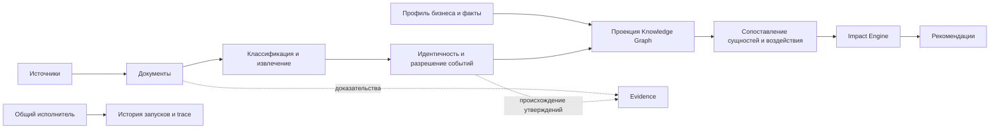
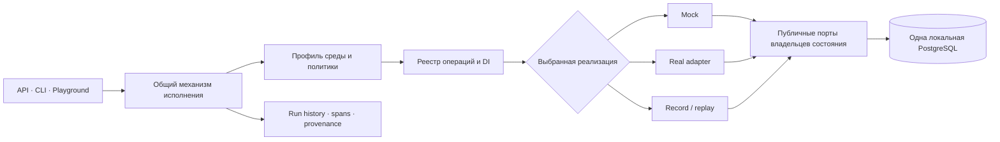

# Alfabank_hack_winwin

[](docs/specs/framework-v1/10-implementation-plan.md)
[](https://github.com/artemnoor/Alfabank_hack_winwin/tree/v0.1.0-bootstrap)
[](https://github.com/artemnoor/Alfabank_hack_winwin/releases)
[](toolchain.lock.json)
[](toolchain.lock.json)
[](toolchain.lock.json)

> Модульный AI-каркас для хакатона Альфа-Банка: строгие контракты операций, заменяемые реализации, контролируемые моки и воспроизводимые запуски.

Это заготовка для быстрого приспособления к ещё не опубликованному кейсу, а не готовый аналитический продукт. **T00 завершена; T01 содержит строгие контракты; T03 добавляет API-вертикальный срез `Documents.prepare` и минимальный Playground.** Остальные операции, постоянное хранилище запусков, полноценная история и replay ещё не реализованы.

## Состояние проекта

| Показатель | Состояние |
|---|---|
| Текущий этап | **T03: локальный API и workbench для `Documents.prepare`; интеграция ожидается** |
| Последний Git-тег | [`v0.1.0-bootstrap`](https://github.com/artemnoor/Alfabank_hack_winwin/tree/v0.1.0-bootstrap) |
| GitHub Release | Пока не опубликован; тег отмечает bootstrap-снимок |
| Framework Ready | Нет — запланирована приёмка T18 после реализации каркаса |
| CI | Ещё нет; матрица проверок предусмотрена задачей T17 |
| Локальная проверка T00 | Windows и Linux userland в WSL; отдельный Linux-хост ещё не проверялся |

Значки выше отражают только текущий этап и закреплённые версии инструментов. Они **не** означают, что AI-алгоритмы готовы или что система прошла CI.

## Что строим

Целевая система — модульный монолит с 25 публичными операциями. У каждой операции будут собственные строгие входные и выходные схемы, HTTP-вызов, mock и fixtures; модули смогут иметь несколько независимых реализаций. Общий исполнитель будет использоваться продуктовым API, CLI, сценариями и Developer Playground.

### Целевой поток данных

Диаграмма показывает направление проектирования из спецификации; её блоки пока не являются реализованными сервисами.



### Целевое выполнение операции



Основные архитектурные границы:

- Модули общаются типизированными интерфейсами; HTTP нужен для независимого вызова операций, а не как обязательный внутренний транспорт.
- Мок выбирается явно. Нет автоматического перехода с real на mock.
- Происхождение данных отделено от происхождения исполнения: настоящий алгоритм может обработать синтетические данные.
- Сценарии связывают публичные операции и не заменяют их. Повторное исполнение использует строгий record/replay.
- Knowledge Graph — перестраиваемая проекция утверждений и доказательств, а не единственное хранилище знаний.

## Быстрый старт

Нужны Git, доступ в интернет при первом запуске, CPython 3.12 для запуска bootstrap и Docker Desktop (Windows) либо Docker Engine с Compose v2 (Linux). Поддерживаемый bootstrap toolchain сейчас закреплён для Windows x64 и Linux x86_64 с glibc. Ключи LLM и SDK моделей не нужны.

Из корня репозитория:

```powershell
py -3.12 tools/dev.py bootstrap
py -3.12 tools/dev.py doctor --profile all
```

В Linux используйте `python3.12` вместо `py -3.12`:

```sh
python3.12 tools/dev.py bootstrap
python3.12 tools/dev.py doctor --profile all
```

Bootstrap ставит точный CPython через закреплённый uv, проверяет SHA-256 архивов uv и Node.js/npm, синхронизирует lock-файлы и запускает только PostgreSQL. Он создаёт раздельные `development` и `testing` базы с отдельными ролями. Пароли и состояние остаются в игнорируемом `.local/`; повторный bootstrap сохраняет credentials и данные.

Успешный `doctor` завершает вывод строкой `Проверки T00 пройдены. Это ещё не Framework Ready.` Эта команда проверяет toolchain и базу, но не запускает API или Playground. Для T03 используйте инструкции в [`apps/api/README.md`](apps/api/README.md) и [`apps/playground/README.md`](apps/playground/README.md).

### Проверка контрактов T01

После bootstrap синхронизируйте закреплённое Python-окружение, проверьте генерацию Pydantic-моделей и запустите контрактные тесты:

```powershell
& .local/toolchain/bin/uv.exe sync --all-groups --locked --python 3.12.15
& .local/toolchain/bin/uv.exe run --locked --python 3.12.15 python tools/contracts_codegen.py --check
& .local/toolchain/bin/uv.exe run --locked --python 3.12.15 pytest tests/contracts -q
```

Инструкции для Linux/WSL и описание публичной поверхности контрактов — в [packages/contracts/README.md](packages/contracts/README.md). Эти проверки не требуют PostgreSQL или ключей моделей.

### Проверка T03

При готовом закреплённом окружении API запускается через Uvicorn, CLI принимает DTO `Documents.prepare` из JSON-файла или stdin, а Playground запускается через Vite. Проверки T03:

```powershell
& .local/toolchain/bin/uv.exe run --locked --python .local/toolchain/python/cpython-3.12.15-windows-x86_64-none/python.exe pytest tests/api -q
& .local/toolchain/bin/uv.exe run --locked --python .local/toolchain/python/cpython-3.12.15-windows-x86_64-none/python.exe python -m alfalab.cli prepare --request .\prepare-request.json
& .local/toolchain/bin/uv.exe run --locked --python .local/toolchain/python/cpython-3.12.15-windows-x86_64-none/python.exe python tools/contracts_codegen.py --check
& .local/toolchain/node/node-22.23.3-windows-x64/node-v22.23.3-win-x64/npm.cmd --prefix apps/playground run typecheck
& .local/toolchain/node/node-22.23.3-windows-x64/node-v22.23.3-win-x64/npm.cmd --prefix apps/playground test
& .local/toolchain/node/node-22.23.3-windows-x64/node-v22.23.3-win-x64/npm.cmd --prefix apps/playground run build
```

## План работ

| Этап | Результат | Статус |
|---|---|---|
| T00 | Toolchain, PostgreSQL, bootstrap и doctor | ✅ Выполнено |
| T01 | Pydantic v2-модели, семантические валидаторы и типизированные descriptors 25 операций | Аудит PASS; исправления ожидают PR review |
| T02 | Общие fixtures и публичные Protocol | После приёмки T01 |
| T03 | Общий исполнитель, HTTP/CLI и минимальный Playground для `Documents.prepare` | Реализован локально; интеграция ожидается |
| T04–T06 | Хранилище запусков, политики данных и replay | Запланировано |
| T07–T14 | Sources/Documents, Understanding/Events, Business, Evidence, Graph и аналитические операции | Запланировано |
| T15–T17 | Playground, сценарии и CI readiness matrix | Запланировано |
| T18 | Чистая приёмка, полный сквозной сценарий и отчёт Framework Ready | Запланировано |

Приёмка Framework Ready не означает, что модели прошли оценку качества или что подтверждена готовность продукта. Это отдельные уровни **Algorithm Ready** и **Product Ready**. Полные зависимости, владельцы и критерии каждого этапа — в [плане реализации](docs/specs/framework-v1/10-implementation-plan.md).

## Документы

| Документ | Для чего |
|---|---|
| [Спецификация v1.0](docs/specs/framework-v1/README.md) | Содержание, статус и нормативность решений |
| [Архитектура](docs/specs/framework-v1/01-architecture.md) | Слои, границы модулей, зависимости и владельцы данных |
| [Контракты и операции](docs/specs/framework-v1/02-contracts.md) · [каталог 25 операций](docs/specs/framework-v1/03-operations.md) | Типы, версии, API и семантика операций |
| [Исполнение](docs/specs/framework-v1/04-execution.md) · [хранилище](docs/specs/framework-v1/05-storage.md) | DI, политика, побочные эффекты и состояние |
| [Сценарии и replay](docs/specs/framework-v1/06-replay-scenarios.md) · [Playground](docs/specs/framework-v1/07-playground.md) | Остановка, воспроизведение и ручные эксперименты |
| [Проверки](docs/specs/framework-v1/08-verification.md) · [локальные данные](docs/specs/framework-v1/09-local-data.md) | CI, уровни готовности, секреты и политика данных |
| [Риски и решения](docs/specs/framework-v1/11-decisions-risks.md) | Принятые компромиссы и открытые вопросы |
| [OpenAPI](docs/specs/framework-v1/contracts/openapi.json) · [примеры контрактов](docs/specs/framework-v1/contracts/examples.json) · [исполняемый пакет контрактов](packages/contracts/README.md) | Нормативные снимки схем, примеры и Pydantic API |

## Релизы и участие

Последний тег [`v0.1.0-bootstrap`](https://github.com/artemnoor/Alfabank_hack_winwin/tree/v0.1.0-bootstrap) фиксирует базовую среду T00. Отдельный [GitHub Release](https://github.com/artemnoor/Alfabank_hack_winwin/releases) пока не опубликован; этот тег не обозначает готовность приложения.

Для разработки выберите незаблокированную задачу из плана и её критерии приёмки. Изменения контрактов требуют проверки затронутых потребителей; секреты, `.local/`, `.venv/` и `node_modules/` в коммиты не добавляются. CI-конфигурации пока нет; контрактные тесты T01 запускаются локально, а общая CI-матрица предусмотрена T17.

**Лицензия:** пока не выбрана. Публичная видимость репозитория не задаёт условия повторного использования кода.
