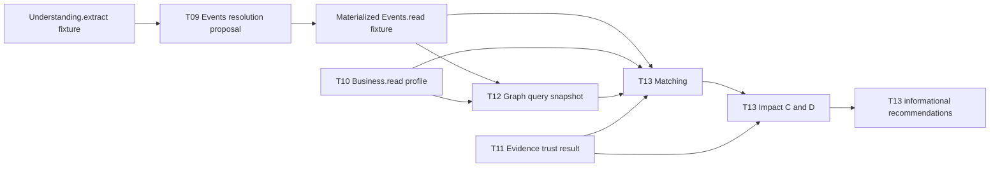

# T09–T13 integration report

## Scope and frozen inputs

The experiment uses only provisional synthetic dataset
`t09-t13-independent-v1` v1.0.1, canonical SHA-256
`sha256:f8a8a275a61e894ccb9dc1d9e3eaae46745467d6630db2a085466ad7e8372725`.
An independent dataset review found no Critical/High/Medium findings and one
documented Low note. The dataset remains provisional and is not approved gold.
Every module receives explicit materialized input; modules do not call one
another's storage, T08, a network service, or a live model.

Prepared operation exchanges are strictly validated for `Understanding.extract`,
`Events.read`, `Business.read`, `Evidence.read`, and `Graph.query`. Module
requests/responses use the existing Pydantic v2 contracts. OpenAPI, generated
DTOs, approved fixtures, and production code are unchanged.

## Materialized handoff

The pipeline passes immutable read results explicitly. The harness does not
claim that `Events.apply`, `Business.apply`, `Evidence.register`, or
`Graph.publish` committed a proposal to production owner state. T09 and T12
may model isolated apply/publish operations only within their local test state.

## Cross-module scenarios

[`integration/test_materialized_pipeline.py`](integration/test_materialized_pipeline.py)
contains eight checks for the requested scenarios and operation seams.

| Scenario | Verified property |
|---|---|
| A — export restriction, unknown supplier | No graph path; T10 keeps sourcing unknown and asks about supplier geography; T13 returns unknown, no mechanism or invented financial quantity. |
| B — explicit supplier/component path | T13 uses only supplied edge IDs, returns a conditional mechanism, and leaves likelihood/materiality/financial loss appropriately uncertain. |
| B + T11 handoff | The explicit `supported_unconfirmed` / `not_confirmed` T11 result reaches T13; C/D remain `potential`, retain `/event/trusted_confirmation`, and do not calculate a loss. |
| C — duplicate export publications | T09 proposes one merge, retains both mention IDs, and does not apply the proposal to a database. |
| D — stale graph and disputed stock | Stale scope yields unknown; a contradictory input stays potential with contradiction visible and no numeric loss. |
| E — industry similarity only | No path, mechanism, confident impact, or recommendation. |
| Evidence seam | A verified anchor is distinguished from factual confirmation; T11 returns `supported_unconfirmed` / `not_confirmed`. |
| Graph seam | T12 edges use explicit Business statement refs; T13 path IDs and statement lineage must exist in the supplied materialized Graph.query snapshot. |

The complete eight-check integration suite passed **8/8** after adding the
explicit T11→T13 handoff regression and the T12 lineage-safety remediation.

## Module status

| Module | Latest suite | Independent review | Current gate |
|---|---:|---|---|
| T09 Events | 113 passed | Five original HIGH findings verified fixed; opaque request-policy reference is not bound to runtime owner policy | NOT READY pending owner policy binding |
| T10 Business | 90 passed | Re-review found no open Critical/High; remediation verified | NOT READY pending typed warehouse/service ontology and `Business.read` receipt path |
| T11 Evidence | 53 passed | Original HIGH and MEDIUM remediation re-reviewed; no auto-confirmation | NOT READY for production until trusted owner policy and persistence/read handoff are governed |
| T12 Graph | 57 passed | Independent final re-review closed the HIGH (unresolved lineage) and MEDIUM (aggregate-local ID collision); one LOW diagnostic gap remains. | NOT READY pending documented DTO/owner gaps |
| T13 analytics | 63 passed | Both original HIGH findings verified fixed; remaining MEDIUM handoff/harness gaps documented | NOT READY pending trusted T11 policy handoff, owner authentication, and broader Events.read corpus |

### Independent review reports

- T09: [`RE_REVIEW.md`](T09/results/RE_REVIEW.md) — original HIGH probes no longer reproduce; runtime policy-reference binding remains open.
- T10: [`RE_REVIEW.md`](T10/results/RE_REVIEW.md) — no open Critical/High; receipt read and typed owner ontology remain documented gaps.
- T11: [`RE_REVIEW.md`](T11/results/RE_REVIEW.md) — requested HIGH/MEDIUM defects no longer reproduce; confirmation remains under an explicit trusted-owner policy.
- T12: [`RE_REVIEW.md`](T12/results/RE_REVIEW.md) — initial module review. [`SCOPED_FRESHNESS_RE_REVIEW.md`](T12/results/SCOPED_FRESHNESS_RE_REVIEW.md) independently reproduced the scoped patch's HIGH. [`FINAL_RE_REVIEW_AGGREGATE_SCOPED_FRESHNESS.md`](T12/results/FINAL_RE_REVIEW_AGGREGATE_SCOPED_FRESHNESS.md) verifies the HIGH and MEDIUM remediations; no Critical/High/Medium findings remain, with one LOW diagnostic gap documented.
- T13: [`RE_REVIEW.md`](T13/results/RE_REVIEW.md) — original HIGH findings fixed on contract entry points; T11 handoff/policy provenance and scenario coverage gaps remain.

## Verification evidence

Latest recorded module results use Python 3.12.15, the existing project venv,
pytest cache disabled, and no new dependencies:

| Check | Result |
|---|---:|
| Framework contract tests | 31 passed |
| T09 suite | 113 passed |
| T10 suite | 90 passed |
| T11 suite | 53 passed |
| T12 suite after aggregate-scoped lineage remediation | 57 passed |
| T13 suite after trust/provenance remediation | 63 passed |
| Shared dataset validator | 13 checks passed, 0 failed |
| Integration suite, including T11 handoff and T12 graph seam | 8 passed |
| Total isolated test suites | 415 passed, 0 failed |
| Contract code generation check | Passed with pinned generator on `PATH` |

Module suites were run separately because multiple module test trees define
`conftest.py` and combined collection aliases those imports. Tests cover
positive/negative results, strict DTO compatibility, unknown and incomplete
inputs, conflicts, boundaries, determinism, provenance, metamorphic behavior,
security, and regression cases. Coverage was not measured.

Offline algorithm experiments were run on provisional synthetic material only:

- T09: 32 focus decisions; merge precision/recall 1.0 each on a single positive
  merge case; false merges 0/31, false splits 0/31, defer 11/71.
- T10: 22 business-profile/question scenarios.
- T11: 12 trust/evidence scenarios, including copied-source independence and
  no automatic confirmation.
- T12: 15 graph property cases, including direct/indirect, unknown, conflict,
  historical and alternate ontology cases.
- T13: 30 C/D scenarios; safety counters zero; no sector-only mechanism;
  finance quantities remain null in contract assessments. Live model quality,
  latency, and cost are **NOT MEASURED**.

These results measure deterministic harness behavior, not real-world accuracy.
Algorithm quality remains **PRELIMINARY** for every module.

## Readiness and unresolved owner decisions

**Integration readiness: NOT READY.** Independent T12 re-review confirms the
HIGH and MEDIUM findings are closed; one LOW diagnostic gap remains documented.
The requested T09/T10/T11/T13 high-severity remediation probes are closed.
Framework integration still needs
the following explicit owner decisions:

- T09 needs an approved policy registry/adapter that binds the request's
  `VersionedRef` to runtime resolution parameters.
- T10 needs approved predicate/typed warehouse-service representation and a
  materialized receipt read source.
- T11 needs a trusted confirmation owner policy and governed storage/read
  integration; a verified anchor does not confirm the underlying fact.
- T12 `KnowledgeSlice` has no aggregate hash and `StatementRef` has no
  `selection_key`, so Graph.query cannot independently compare the full
  aggregate ref hash against current owner state. GraphEdge also lacks native
  negative polarity and per-edge valid-time fields; the spike keeps these
  distinctions in explicit sidecar data.
- T13 normative DTOs carry neither T11 result nor trusted owner policy
  provenance. The spike passes a materialized result through an internal
  adapter for the integration scenario; approval/authentication of that
  adapter is still required. The 30-case harness has 18 event IDs without a
  corresponding prepared `Events.read` record. Impact numeric scenario inputs
  and the approved recommendations catalog also need owner-level decisions.

No live LLM, embeddings API, vendor service, database, or external data source
was called. No commercial service or closed dataset is treated as open source.
The new artifacts are isolated under `spike/`; T08 and `main` remain untouched.
