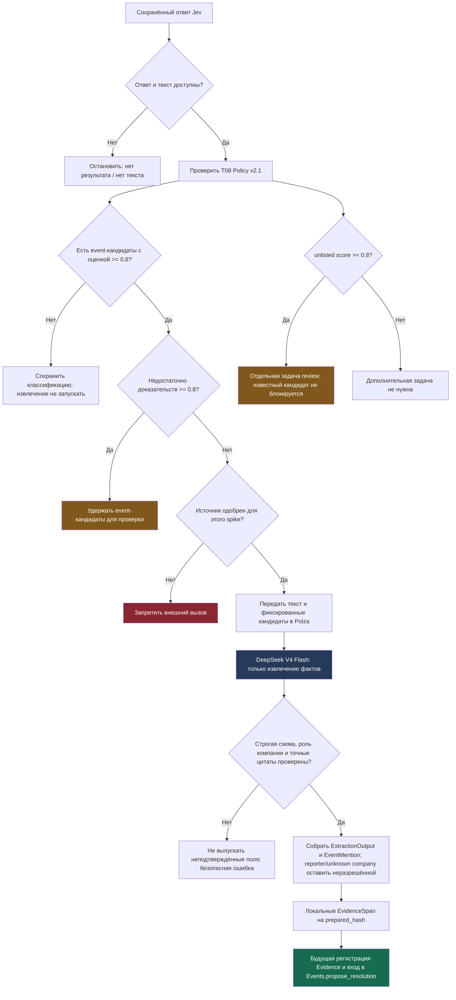

# Экспериментальный поток извлечения

Это схема экспериментального адаптера. Ветка извлечения не принимает решение,
истинно ли событие: все statements остаются `unknown`, `hypothetical` или
`disputed`. Реальная регистрация Evidence и работа Events в T09 здесь не
реализованы.
